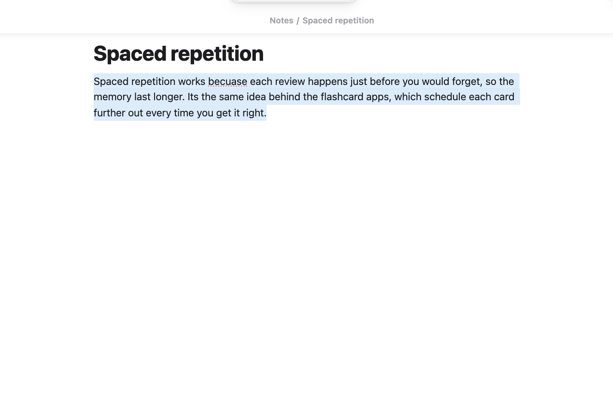

# Tahoe Intelligence

**On-device AI for your notes.** Ask your notes a question and get an answer with citations, see the notes related to the one you're reading, turn a rough note into a permanent one, proofread and rewrite a selection, find the tasks in your sentences, and draft a weekly review. It all runs on your Mac with Apple Intelligence (free and private), or with a local [Ollama](https://ollama.com) model. Nothing in a note changes until you've reviewed it.



- Select a paragraph, click ✦ and **Proofread**: each change is marked, then *Replace*.
- *Ask your notes…* "what did we decide about the robot demo?" answers from your notes, with [1] [2] links to the passages.
- *Find tasks in this note* turns "email the prof before Friday" into a task due on Friday.

## Features

- **Ask your notes** (*Ask your notes…*): ask in words and get an answer written only from your notes, with [1] [2] citations that open the passage they came from. It finds notes by meaning and by distinctive words, so short notes and formulas are found too. Follow-up questions keep the thread, and *Save as note* keeps the answer.
- **Related notes** (right sidebar, *Show related notes*): the notes closest in meaning to the one you're reading, each with a line of its text. **Link** adds a link at the cursor, or drag a row into the note. Daily notes, reviews and maps are left out, since they relate to everything.
- **Writing help**: select text and use the ✦ button, the right-click menu or the command palette. Proofread (shows each change), Rewrite, Friendly, Professional, Concise, Summary, Key points, List or Table, then *Replace*, *Insert below* or *Copy*.
- **Distill into a permanent note** (command, or right-click a note): turns a rough fleeting note into a one-idea draft, with a title phrased as a claim, a few sentences in plain words, and the closest related notes to link. Edit it, then save; the fleeting note is kept and links to the new one.
- **Rename untitled notes and pasted images**: names "Untitled 3" from what it says, and "Pasted image 2026…" from the words in the image, what's in the picture and the note it's in. You review every name; links update as your *Files and links* settings say.
- **Properties**: fills in missing `type`, `course`, `status` and tags, choosing only from values you already use (plus lists in the settings). *Fill in properties across the vault* works in the background, pauses while you type and saves the suggestions for review.
- **Link suggestions by meaning**: when you pause after a paragraph, a quiet ✦ chip at its end suggests a note it relates to. Click it to add the link.
- **Task extraction** (*Find tasks in this note*, or in the notes you edited this week): sentences like "email the prof before Friday" become checkboxes with due dates under a *Tasks* heading. Dates are worked out from today in code, not guessed by the model. Formats for the Tasks plugin (📅), Dataview or plain text.
- **Weekly review** (*Write weekly review*): reads what changed in your Projects and Areas this week, gathers open tasks by due date, and drafts a review with highlights and three tasks to focus on next.
- **Map of content** (*Make a map of content…*, or right-click a folder): reads each note in a folder or about a topic and writes a map with the notes grouped under headings and a line on each.

### With Tahoe Organize and Tahoe Math

- **Inbox triage**: each inbox note gets a suggested folder (from your real folders), tags (only ones similar notes already use) and a better title. **Tab** accepts them.
- **Duplicate ideas**: Organize's vault health gets *Notes that may say the same thing*, with **Compare**, **Merge** and **Keep both**.
- **Smart folders by topic**: an **About** rule, like *About: dynamic programming*, that finds notes by meaning.
- **Maths in words**: `days until Oct 14 =` in Tahoe Math becomes a calculation.

### Reminders and Calendar (off until you turn them on)

- **Deadlines in Reminders**: tasks with a due date go into a Reminders list, so they show on your iPhone and lock screen. It syncs both ways: ticking one off in Reminders ticks it in the note, and reminders you add to the list become tasks in a note.
- **Calendar**: reads your calendars (any account in the Calendar app, Google included). *Insert today's agenda*, *Make a meeting note…* from an event, and your week in the weekly review.

Turn them on under *Tools* in Tahoe Intelligence's settings and restart Obsidian; macOS asks you to allow Obsidian the first time.

## Requirements

- **Apple Intelligence**: a Mac with macOS 26 or later and Apple Intelligence turned on, plus Xcode's command line tools (`xcode-select --install`), which build a small helper the first time (about a minute). Then it reads every note once to build a meaning index.
- **Ollama** can stand in for the model on any desktop, for writing help, distilling, tasks, reviews, renaming and maps. The features that find notes by meaning (ask your notes, related notes, link suggestions, duplicate ideas, topics) use the Mac's text embeddings, so they need the Mac.

Desktop only.

<!-- tahoe-family -->
## The Tahoe family

Tahoe is a set of plugins and a theme that work on their own and fit together.

| | | |
| --- | --- | --- |
| **[Tahoe Run](https://github.com/krishnanefx/obsidian-tahoe-run)** | Run the code in your notes, like a notebook: Python with a debugger and variables view, MATLAB, and ~25 other languages. | available |
| **[Tahoe Math](https://github.com/krishnanefx/obsidian-tahoe-math)** | A calculator in your notes: type an expression ending in `=` and the answer appears. | available |
| **[Tahoe](https://github.com/krishnanefx/obsidian-tahoe-theme)** | A clean, Mac-like theme, in light and dark. | available |
| **[Tahoe Code](https://github.com/krishnanefx/obsidian-tahoe-code)** | An IDE in your code blocks: suggestions, checking as you type, quick fixes, go to definition, formatting and AI edits. | available |
| **[Tahoe Glass](https://github.com/krishnanefx/obsidian-tahoe-glass)** | Real refraction for the Tahoe theme's glass, and header cards on settings pages. | available |
| **[Tahoe Organize](https://github.com/krishnanefx/obsidian-tahoe-organize)** | Keep a growing vault tidy: inbox triage, smart folders, colored tags, link suggestions, vault health, literature notes and text from images. | available |
| **Tahoe Intelligence** | On-device AI for your notes: ask your notes, related notes, distilling permanent notes and more. | this one |

**Better together**

- **With [Tahoe Organize](https://github.com/krishnanefx/obsidian-tahoe-organize):** inbox triage gets a suggested folder, tags and title for each note, vault health finds notes that say the same thing, and smart folders get an About rule that matches by meaning.
- **With [Tahoe Math](https://github.com/krishnanefx/obsidian-tahoe-math):** ask in words: `days until Oct 14 =` becomes a calculation, and Tahoe Math works it out exactly.
- **With [Tahoe Code](https://github.com/krishnanefx/obsidian-tahoe-code):** Apple Intelligence can be the model for Tahoe Code's ghost text, ⌘I edits and equation to code, if you don't use Ollama.
- **With [Tahoe](https://github.com/krishnanefx/obsidian-tahoe-theme):** its sheets and the ✦ button take the theme's glass and corners.
<!-- /tahoe-family -->

## Disclosures

- **It runs a program on your Mac:** a small helper, built once from its Swift source with Xcode's command line tools (`xcrun swiftc`), that talks to Apple's on-device model, text embeddings and text recognition. It runs while Obsidian is open.
- **Network use:** only to Ollama on your own computer (localhost:11434), if it's running. Nothing is sent to the internet.
- **Files outside your vault:** the helper and the meaning index are kept in `~/Library/Caches/tahoe-intelligence` (not synced).
- **Other apps, only if you turn them on:** Reminders (it reads and writes the one list you choose) and Calendar (read only), through macOS's own permission prompts.
- **Clipboard:** it writes to the clipboard only when you press Copy. It never reads it.
- **No telemetry, ads, accounts or payments.**

## Credits

Tahoe Intelligence is an independent project. It isn't affiliated with, or endorsed by, Apple or Ollama.

## License

[MIT](LICENSE) © 2026 Krishnan Adaikkappan

## Building from source

```sh
npm ci
npm run build     # writes main.js
```

Releases are built by GitHub Actions: push a tag that matches the version in `manifest.json`, then publish the draft release it creates.
